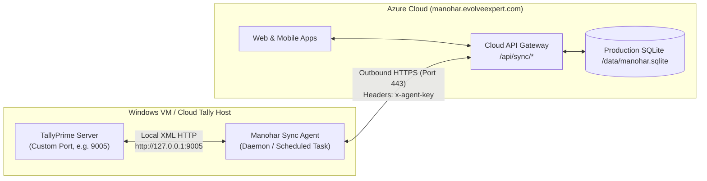

# Manohar Traders - Cloud Tally & Sync Agent Backend Configuration Guide

This technical guide is written for the **Backend / DevOps / IT Systems Team** responsible for configuring and running the **TallyPrime Cloud Sync Agent** alongside TallyPrime (local server or Cloud-hosted Windows VM).

---

## 1. Architecture & Network Topology

The Manohar Traders platform consists of two main components:
1. **Cloud SaaS Platform** (Azure Cloud): Hosted at `https://manohar.evolveexpert.com`
2. **Sync Agent & TallyPrime** (Windows Server / Cloud VM): Runs on the machine where TallyPrime is installed.



### Key Network & Security Rules
- **No Inbound Public Ports Required on Tally VM:** The Agent only makes **outbound** HTTPS requests to `https://manohar.evolveexpert.com:443`. No public IP or open inbound port to the Internet is needed.
- **Local Tally Port:** TallyPrime only needs to accept local HTTP connections from `127.0.0.1` (localhost).
- **Port Flexibility:** **Port 9000 is NOT required**. Any free TCP port (e.g. `9001`, `9005`, `9050`, `9999`) can be configured in Tally and the Agent.

---

## 2. Step 1: Configure Port in TallyPrime

If port 9000 is blocked or used by another application (e.g., SonarQube, PHP, internal tools), configure an alternative port:

1. Open **TallyPrime** on the server.
2. Ensure the active company (e.g. **Manohar Traders**) is loaded and open.
3. Press **`F1` (Help)** $\rightarrow$ Select **Settings** $\rightarrow$ Select **Connectivity**.
4. In the **Client/Server configuration** screen:
   - **TallyPrime acts as:** Set to `Both` (or `Server`).
   - **Enable ODBC Server:** Set to `Yes`.
   - **Port:** Set to your chosen port (e.g., `9005` or `9001`).
5. Press **`Ctrl + A`** to accept and save.
6. **Restart TallyPrime** for the port listener to take effect.

> **Verification:** Open PowerShell or Command Prompt on the Tally machine and verify Tally is listening:
> ```powershell
> netstat -ano | findstr 9005
> ```
> You should see `TCP 0.0.0.0:9005 LISTENING` or `TCP 127.0.0.1:9005 LISTENING`.

---

## 3. Step 2: Download & Extract the Agent

1. Download the pre-packaged Windows distribution bundle:
   - **Direct URL:** `https://manohar.evolveexpert.com/tally-agent-windows.zip`
2. Extract the ZIP file to a permanent directory on the server (e.g., `C:\ManoharAgent` or `D:\Services\ManoharAgent`).
   > ⚠️ **Important:** Do NOT run files directly from inside the `.zip` archive without extracting.

### Contents of the Package
| File | Description |
|---|---|
| `node.exe` | Bundled portable Node.js runtime. No system Node.js installation required! |
| `tally-agent.mjs` | Standalone compiled agent binary with XML parsers and sync engine. |
| `agent-state.json` | Configuration file containing tenant IDs, keys, and Tally URL. |
| `run-agent.bat` | Interactive Windows console utility for status checks, manual sync, and configuration. |
| `install-service.bat` | Windows administrator script that installs the 24/7 background watchdog task. |
| `uninstall-service.bat` | Removes the 24/7 background task if needed. |
| `watchdog.bat` | Self-healing supervisor loop that restarts the agent in 5s if it ever drops. |
| `run-silent.vbs` | Runs the watchdog completely hidden in the background without pop-ups. |
| `README.txt` | Quick reference cheat sheet. |

---

## 4. Step 3: Configure Agent Settings

Open `agent-state.json` in Notepad or your preferred editor:

```json
{
  "cloudUrl": "https://manohar.evolveexpert.com",
  "companyId": "c-1793000752410",
  "companyName": "Manohar traders",
  "agentSecretKey": "agt_a060dc3b5a57140ec88d95e9e7de47e0294fde6025bbaf77",
  "tenantId": "tenant-manohar-traders-2365",
  "tallyUrl": "http://127.0.0.1:9005",
  "pollIntervalMs": 30000,
  "lastAlterId": 0
}
```

### Parameter Reference
- **`tallyUrl`**: Set this to `http://127.0.0.1:<PORT>` matching the port you configured in TallyPrime (e.g., `http://127.0.0.1:9005`).
- **`cloudUrl`**: `https://manohar.evolveexpert.com` (already pre-configured).
- **`companyId`** & **`agentSecretKey`**: Tenant authentication credentials (already pre-configured).
- **`pollIntervalMs`**: Sync frequency in milliseconds (default: `30000` = 30 seconds).
- **`lastAlterId`**: Incremental tracker. Leave as `0` for initial full synchronization.

*(Alternatively, you can run `run-agent.bat`, choose **Option [5] Configure Settings Manually**, and type the new Tally URL).*

---

## 5. Step 4: Validate Connection & Run First Sync

1. Double-click `run-agent.bat`.
2. Select **`[1] Check Status / Test Connection`**.
   - Expected Output:
     ```text
     [Local Tally Configuration]
     Tally URL:  http://127.0.0.1:9005
     Connection: ONLINE
     Mode:       Live Tally (http://127.0.0.1:9005)
     Active Co:  Manohar Traders

     [Cloud SaaS Configuration]
     Cloud URL:  https://manohar.evolveexpert.com
     Company ID: c-1793000752410 (Manohar traders)
     Cloud Link: CONNECTED (Server time: 2026-11-06T...)
     ```
3. Select **`[2] Run Manual 2-Way Sync Now`**.
   - This performs an immediate sync cycle:
     - Reads all Ledgers (Sundry Debtors / Creditors) and AlterIDs.
     - Reads all Outstanding Bills (pending dues and aging).
     - Reads Stock Items, Units, and Closing Balances.
     - Pushes them to the cloud database.
     - Checks the Cloud Outbox for any pending delivery challans to write back to Tally.

---

## 6. Step 5: Enable 24/7 Unattended Service (Auto-Restart)

To ensure synchronization continues permanently in the background without needing a user logged in:

1. Right-click **`install-service.bat`** and select **Run as Administrator**.
2. This creates a Windows Scheduled Task:
   - **Task Name:** `ManoharTallySyncAgent`
   - **Trigger:** Runs automatically at Windows boot / startup.
   - **Execution Mode:** Launches silently via `run-silent.vbs` without opening any command prompt windows.
   - **Watchdog Supervisor:** If Tally crashes or the agent process closes, the watchdog automatically restarts it after 5 seconds.
   - **Log File:** All live sync events, timestamps, and errors are appended to `agent.log` in the folder.

### Useful Service Operations
- **Check Live Activity:**
  Open PowerShell in the agent folder and run:
  ```powershell
  Get-Content agent.log -Tail 30 -Wait
  ```
- **Stop Service:**
  Open `run-agent.bat` or run:
  ```powershell
  schtasks /End /TN "ManoharTallySyncAgent"
  taskkill /F /IM node.exe
  ```
- **Uninstall Service:**
  Right-click **`uninstall-service.bat`** and run as Administrator.

---

## 7. Troubleshooting & Common Scenarios

| Issue | Cause | Solution |
|---|---|---|
| `Cannot reach Tally at http://127.0.0.1:<PORT>: ECONNREFUSED` | Tally is not running or port does not match. | 1. Ensure TallyPrime is open.<br/>2. Verify port in Tally (**F1 $\rightarrow$ Settings $\rightarrow$ Connectivity**).<br/>3. Ensure `agent-state.json` matches the same port. |
| `Tally response: No Company is currently open` | Tally is open, but no company is loaded. | Open **Manohar Traders** company inside TallyPrime. |
| `Cloud Link: AUTH/SERVER ERROR (401 or 403)` | Invalid `agentSecretKey` or `companyId`. | Verify credentials in `agent-state.json` match the organization in Web Settings $\rightarrow$ Desktop Tally Agent. |
| `Port already in use` error in Tally | Another service is using the chosen port. | Run `netstat -ano \| findstr <PORT>` to find the PID, or switch Tally to a different port (e.g. try `9005`, `9050`, or `9999`). |
| Windows Firewall Blocking | Windows Defender blocks port binding. | Add an Inbound Rule in Windows Firewall permitting TCP on the chosen port for `127.0.0.1` (Private Network). |

---

## 8. Summary Checklist for Backend Team

- [ ] Choose an available port (e.g., `9005`).
- [ ] Set port in TallyPrime (**F1 $\rightarrow$ Settings $\rightarrow$ Connectivity**), enable ODBC/Server, save (`Ctrl+A`), and restart Tally.
- [ ] Extract `tally-agent-windows.zip` to `C:\ManoharAgent`.
- [ ] Edit `tallyUrl` in `agent-state.json` to `http://127.0.0.1:9005`.
- [ ] Run `run-agent.bat` $\rightarrow$ Option `[1]` to verify both Tally and Cloud show **ONLINE / CONNECTED**.
- [ ] Run `run-agent.bat` $\rightarrow$ Option `[2]` to trigger initial sync.
- [ ] Right-click `install-service.bat` $\rightarrow$ **Run as Administrator** to start 24/7 background automation.
- [ ] Verify live data appears in `https://manohar.evolveexpert.com` (Parties, Stock, Outstanding Dues).
